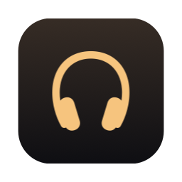
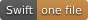
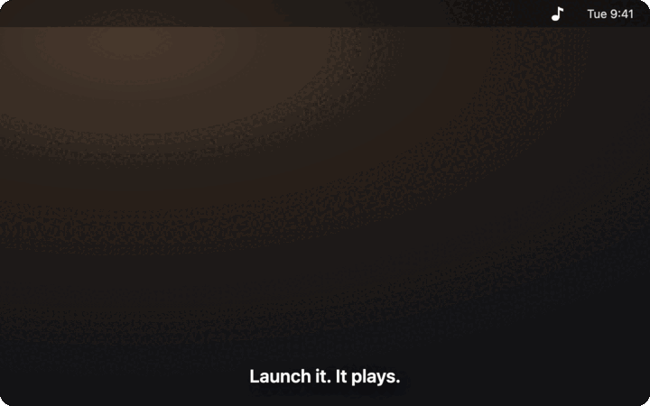

<p align="center">
  
</p>

<h1 align="center">Focus Nota</h1>

<p align="center">
  <b>Music for deep work, one click away. Or one sentence to your AI agent.</b><br>
  A tiny macOS menu bar player: launch it and it plays. No window, no library, no account,
  just a note in the menu bar and your long mixes.
</p>

<p align="center">
  
  
  
  
</p>

<p align="center">
  
</p>

## Install

```bash
git clone https://github.com/martinandrt/focus-nota && cd focus-nota
bash build.sh --install       # builds "Focus Nota.app" into ~/Applications
```

Needs Xcode command line tools. Put your mixes (mp3, m4a, wav, aiff, flac) in `~/Desktop/Focus music/`,
one subfolder per station, then open the app from Spotlight with *focus*. Another folder:

```bash
defaults write cz.martinandrt.focus musicFolder "~/Music/Focus"   # then quit and reopen the app
```

`build.sh` signs with your "Apple Development" certificate if you have one. Without it the build is signed ad hoc,
and macOS asks for folder access again after every rebuild.

## How it works

- **It plays the moment it opens** and starts at login, so music is one click away all day.
- **It remembers where you stopped.** Quit in the middle of a two-hour mix, open it tomorrow, it carries on.
- **Stations are folders.** Add a folder, get a station. **Mix** shuffles everything.
- **The note dims when paused.** That is the whole interface.

## Let your AI agent DJ

The app takes commands from the terminal, so an agent like Claude Code can pick music for you.
Tell it *"I need focus music, something energetic"*; it reads the list of mixes and queues a few.

```bash
NOTA="$HOME/Applications/Focus Nota.app/Contents/MacOS/Nota"
"$NOTA" --list                       # stations and mixes with lengths
"$NOTA" --cmd pick "Vivaldi" "Bach"  # queue mixes whose names contain these words
"$NOTA" --cmd station "Electronic"   # or: mix, pause, play, next
"$NOTA" --status                     # what is playing and where
```

Every `--cmd` waits for the app to answer: `ok: <station> · <mix>` and exit code 0, or `error: …` and exit code 1,
so the agent knows the music really changed.

---

Built for my own deep work with Claude Code. The UI follows your system language (English or Czech). MIT license.
